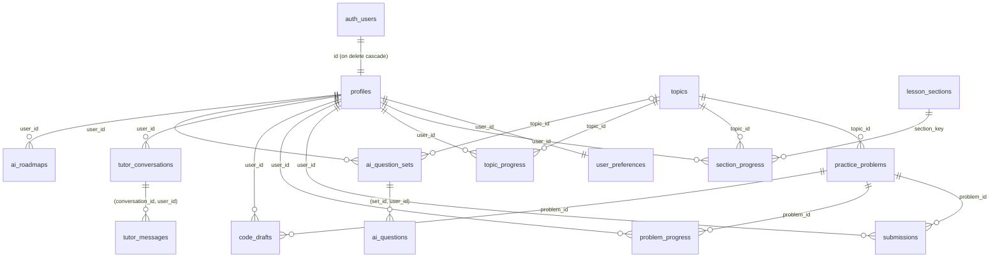

# AlgoVerse database (Supabase / PostgreSQL)

Migrations live in `supabase/migrations/` and run in file-name order:

| File | Contents |
| --- | --- |
| `20261114120000_algoverse_schema.sql` | Tables, indexes, triggers, views, Row Level Security policies, column-level grants |
| `20261114120100_catalog_seed.sql` | The real curriculum catalog (16 topics, 10 lesson sections, 33 practice problems), **generated** from `src/data` by `npm run db:seed-sql`. Idempotent. |
| `20261116120000_profile_name_from_signup_only.sql` | Sign-up no longer invents a display name from the email; clears names that were auto-filled that way |

No user data, sample data or fake accounts are seeded.

## Who writes what

| Writer | Credentials | Tables it writes |
| --- | --- | --- |
| Browser (supabase-js) | publishable key + the user's JWT → Postgres role `authenticated` | `profiles` (name, username, headline, avatar), `user_preferences`, `section_progress`, `topic_progress.last_visited_at`, `code_drafts`; organising AI content (rename/archive conversations, save questions, activate roadmaps); deleting own rows |
| Express server | secret key → role `service_role` (bypasses RLS) | `submissions` (after Judge0 judged them), `tutor_conversations` / `tutor_messages` (Claude replies), `ai_question_sets` / `ai_questions`, `ai_roadmaps`. `user_id` always comes from the **verified** JWT, never from the request body. |
| Triggers (security definer) | table owner | `profiles` + `user_preferences` on sign-up, `topic_progress` counters, `problem_progress`, `tutor_conversations.last_message_at` |

Because there are no `INSERT` policies or grants for server-produced tables, a user cannot forge an "Accepted" verdict, a tutor reply or a generated question, even with a hand-crafted request using their own valid token.

## Entity relationships

Child rows of conversations and question sets use a **composite foreign key** `(parent_id, user_id)` → parent `(id, user_id)`, so a message can never be attached to another user's conversation.

## Tables

### Catalog (public read, written only by migrations)
- **topics** `id text PK` ('arrays'…), name, level, position (unique), description
- **lesson_sections** `key text PK` ('introduction'…), title, position
- **practice_problems** `id text PK` ('two-sum'…), title, difficulty, `topic_id → topics`, position

### 1. Users and profiles / 8. Preferences
- **profiles** `id uuid PK → auth.users(id) on delete cascade`, display_name, username (unique, case-insensitive), headline, avatar_url (https only), timestamps
- **user_preferences** `user_id PK → profiles`, preferred_language (`java`/`cpp`/`python`), daily_goal (1–20), email_reminders, weekly_report, streak_alerts

Both rows are created by the `on_auth_user_created` trigger. The display name comes only from the `display_name` sign-up metadata; otherwise it is empty, and the app shows "Welcome back!". Email and password live only in `auth.users`, managed by Supabase Auth.

### 2. Learning progress
- **section_progress** PK `(user_id, topic_id, section_key)`, read_at
- **topic_progress** PK `(user_id, topic_id)`. `sections_read` and `completed_at` are maintained by a trigger: a topic is complete when every lesson section is read, and un-reading one reopens it. The client may only set `last_visited_at`.

### 3–4. Practice
- **submissions** `id uuid PK`, user, problem, language, verdict (`accepted`, `wrong_answer`, `compilation_error`, `runtime_error`, `time_limit_exceeded`, `internal_error`), passed/total, runtime_ms, memory_kb, code (≤ 64 KB), created_at
- **problem_progress** PK `(user_id, problem_id)`: status (`attempted`/`solved`), attempts, accepted_count, first/last attempt, solved_at, last_language. Maintained by a trigger on `submissions`; a solved problem never becomes unsolved.
- **code_drafts** PK `(user_id, problem_id, language)`
- **user_practice_stats** (view): solved, attempted, submissions, accepted, solved by difficulty, last activity
- **user_daily_activity** (view): per UTC day, submissions, accepted, problems accepted (for streaks and charts)

Both views use `security_invoker = true`, so they only ever aggregate the caller's own rows.

### 5. AI Tutor
- **tutor_conversations** `id uuid PK`, title, language, optional context (`problem`/`topic` + id), archived, last_message_at
- **tutor_messages** `id bigint identity PK`, role (`user`/`assistant`), content, model, stop_reason, truncated, incomplete, input/output tokens

### 6. Generated questions
- **ai_question_sets**: the request (topic, difficulty, language, focus) and the model
- **ai_questions**: position, title, difficulty, topic, `content jsonb` (statement, signature, examples, constraints, hints, approach), is_saved, status (`new`/`attempted`/`solved`)

### 7. Roadmaps
- **ai_roadmaps**: settings (skill level, target difficulty, weeks, hours, language, goals, weak areas), `input_snapshot` (the progress summary sent to Claude), `plan jsonb`, model, is_active (**at most one per user**, enforced by a partial unique index), completed_weeks
- `activate_roadmap(uuid)` RPC switches the active roadmap atomically. It is `security invoker`, so it obeys RLS.

## Indexes

All primary and foreign keys above, plus:
- `submissions (user_id, created_at desc)`, `(user_id, problem_id, created_at desc)`, `(problem_id)`
- `problem_progress (user_id, status)`, `(user_id, last_attempted_at desc)`
- `topic_progress (user_id, last_visited_at desc)`
- `tutor_conversations (user_id, archived, last_message_at desc)`
- `tutor_messages (conversation_id, id)`, `(user_id, created_at desc)`
- `ai_question_sets (user_id, created_at desc)`, `ai_questions (user_id, is_saved, created_at desc)`
- `ai_roadmaps (user_id, created_at desc)`, a partial unique index on `(user_id) where is_active`
- `profiles (lower(username))` unique

## Row Level Security

RLS is enabled on **every** table. Policies use `(select auth.uid())`, the form Supabase recommends for performance, and target the `authenticated` role. `anon` can read only the catalog. On top of the policies, privileges are narrowed per column: for example, users may update `profiles.display_name` but not `profiles.id`, and `topic_progress.last_visited_at` but not `completed_at`.

> **Adding a table later?** Supabase grants new `public` tables to `anon`/`authenticated` by default. Always `enable row level security`, add policies, and narrow the grants in the same migration.

## Verification performed

The migrations were applied to PostgreSQL 16 with a test-only Supabase shim (the `auth` schema, `auth.uid()`, and the `anon`/`authenticated`/`service_role` roles), and 48 checks passed. Highlights:
- Cross-user isolation on every table
- Users cannot forge verdicts, AI replies, completion or ownership
- The triggers behave correctly
- Deleting an account cascades
- anon sees only the catalog
- The seed is idempotent

They have **not** been run against a hosted Supabase project yet; see "Next steps" in the README.
